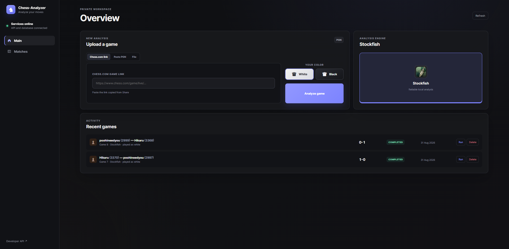
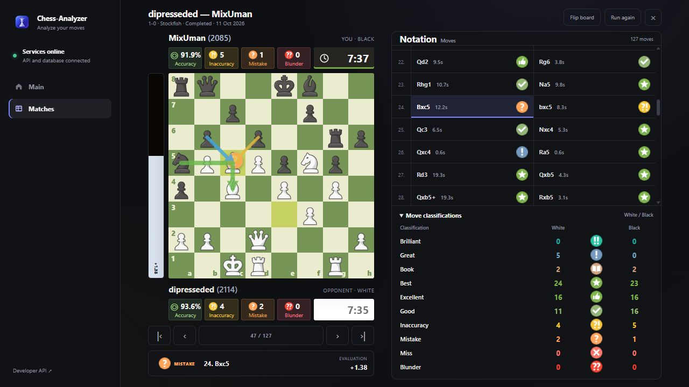

# Chess Analyzer

A local pet project for reviewing chess games with Stockfish.
Import a game from Chess.com, upload a PGN file, or paste PGN text.
The app shows an interactive board, move evaluations, mistakes, and player statistics.

## Stack

- **Backend:** Python 3.12, FastAPI, Uvicorn, Pydantic.
- **Background tasks:** Celery and RabbitMQ.
- **Database:** PostgreSQL, SQLAlchemy, psycopg, Alembic migrations.
- **Chess analysis:** python-chess and Stockfish.
- **HTTP client:** HTTPX for importing games from Chess.com.
- **Frontend:** HTML, CSS, vanilla JavaScript, local images.
- **Tools:** Docker, Docker Compose, pytest.

FastAPI saves the game and queues an analysis job. A Celery worker runs
Stockfish and stores the results in PostgreSQL. The browser polls the API
and displays the analysis.

Completed moves appear during analysis, with a move counter and progress bar.
Review moves animate in 200 ms, including castling, captures and promotions.
Fast navigation continues from each piece's displayed position without queuing
animations. Board animation remains enabled independently of system reduced-motion
preferences, as explicitly requested for this viewer.
The White/Black counters for Brilliant, Great, Blunder and Miss open the first
matching move for that player; zero counters are disabled.
Player country flags load separately from public Chess.com profiles and are
cached for 24 hours. Profiles without a country omit the flag.
The search stays at depth 20. Each position is evaluated once, and the next
position supplies the played move's evaluation. Best played moves receive an
additional full-depth check of the strongest alternative outside the opening.
Book classifications are computed first from the local `openings.json` theory
file, independently of Stockfish. Matching includes terminal positions and legal
transpositions of up to eight plies verified against the same moves in a source
line. Book forms one continuous prefix and stops at the first unrecognized move;
returning to a familiar position afterwards does not restart it. The file is a
finite repertoire, so a theoretical continuation absent from it is evaluated by
the engine. Book positions retain full-depth evaluations for accuracy and the
evaluation chart but skip the additional classification search.
Independent, reused
Stockfish processes search short blocks in parallel while retaining move history.
Three full-depth board arrows are loaded only for the position being viewed,
then cached; navigating quickly does not queue unlimited searches.
The worker caches its last 16 complete games until restart, with keys including
the full move history, engine binary, analysis code, opening book and depth.
The Docker image includes a pinned, checksum-verified Stockfish 15.1 AVX2 build.
Compatible x86 CPUs use it automatically; other CPUs retain the packaged engine.
`STOCKFISH_THREADS=0` automatically selects a
CPU budget of up to eight threads, reserving two on machines with more than
four CPUs; a positive value overrides the total budget. The default 512 MB
hash budget is shared across the concurrently running engines.

## Screenshots

### Main screen



### Game analysis



## Run locally

Install Docker with Docker Compose. From the project folder, create
`.env` from the example if it does not exist, then start the app:

```powershell
Copy-Item .env.example .env
docker compose up --build -d
```

- App: http://localhost:8001
- API docs: http://localhost:8001/docs

The app is intended for local use and has no user accounts.
