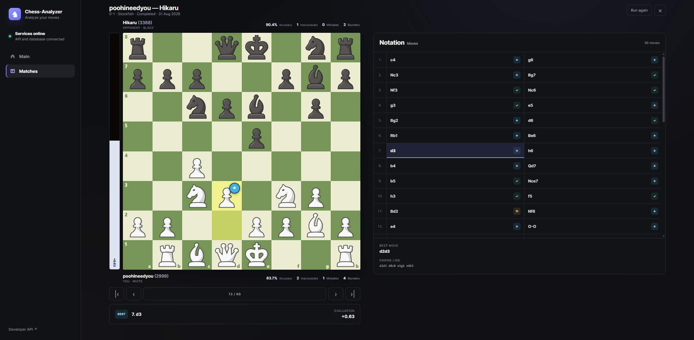

# Chess Analyzer

A local pet project for reviewing chess games with Stockfish.
Import a game from Chess.com, upload a PGN file, or paste PGN text.
The app shows an interactive board, move evaluations, mistakes, and player statistics.

## Stack

- **Backend:** Python 3.12, FastAPI, Uvicorn, Pydantic.
- **Background tasks:** Celery and RabbitMQ.
- **Database:** PostgreSQL, SQLAlchemy, psycopg, Alembic migrations.
- **Chess analysis:** python-chess and Stockfish.
- **HTTP client:** HTTPX for importing games from Chess.com.
- **Frontend:** HTML, CSS, vanilla JavaScript, local images.
- **Tools:** Docker, Docker Compose, pytest.

FastAPI saves the game and queues an analysis job. A Celery worker runs
Stockfish and stores the results in PostgreSQL. The browser polls the API
and displays the analysis.

## Screenshots

### Main screen


### Game analysis



## Run locally

Install Docker with Docker Compose. From the project folder, create
`.env` from the example if it does not exist, then start the app:

```powershell
Copy-Item .env.example .env
docker compose up --build -d
```

- App: http://localhost:8001
- API docs: http://localhost:8001/docs

The app is intended for local use and has no user accounts.

## Tests

With Python 3.12 and an activated virtual environment:

```powershell
python -m pip install -e ".[dev]"
python -m pytest -q
```
